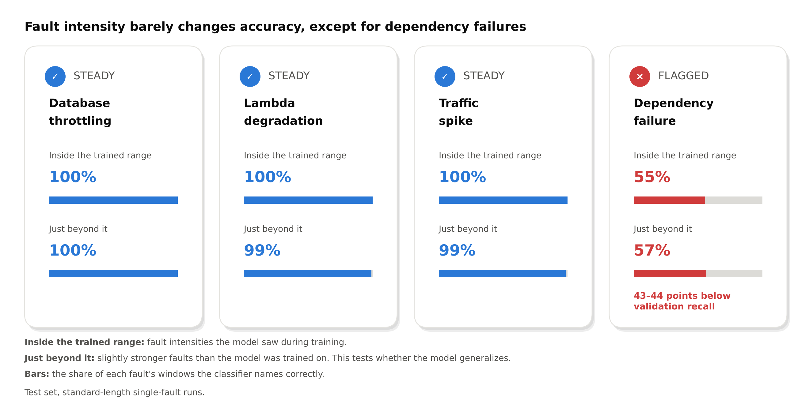
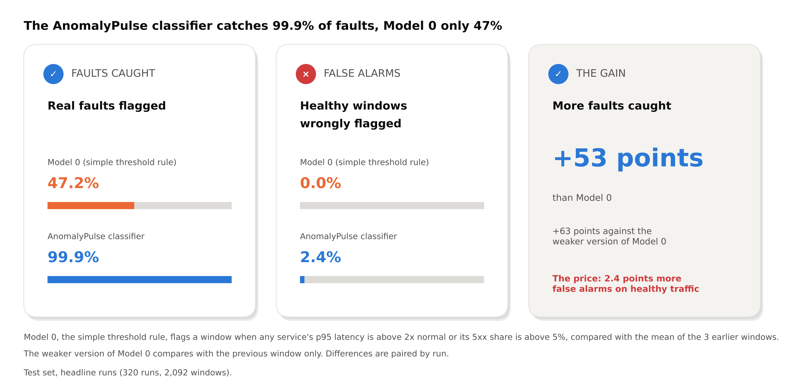
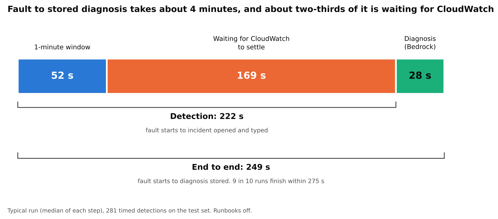

# M9-6 report: latency on the live path, and the report figures

**Status:** final. Latency numbers are from `AnomalyPulse/report/results/latency_m9_6.json`, built from M9-1's live
runs (350 test-set runs, 20 stress runs, 2026-11-13 to 2026-11-16). Every figure is drawn from result files by one
script and can be regenerated (see "How to reproduce"). **Owner:** Linu · **Code:** `AnomalyPulse/report/latency.py`,
`fetch.py`, `make_figures.py` · **Reads:** [`M9-2_REPORT.md`](M9-2_REPORT.md), [`M9-3_REPORT.md`](M9-3_REPORT.md),
[`COST_AND_PERFORMANCE.md`](COST_AND_PERFORMANCE.md), [`PIPELINE.md`](PIPELINE.md),
[`LIVE_DIAGNOSIS.md`](LIVE_DIAGNOSIS.md)

## The short version

- **From the start of a fault to a stored diagnosis takes about four minutes.** The median is 249 s and 9 in 10 runs
  finish within 275 s (281 timed detections on the test set). Detection alone, meaning the fault is noticed and its
  type is named, takes a median of 222 s. Diagnosis (Bedrock, plus storing the result) adds a median of 28 s.
- **Detection is not window-dominated. It is dominated by waiting for CloudWatch.** The ticket expected
  "window-dominated (~1 min)". The one-minute window accounts for about 19% of the mean end-to-end time (median 52 s). The wait for
  CloudWatch to publish and settle the minute's numbers accounts for about 69% (median 169 s). Diagnosis is about 12%.
  The reason is in "Why the wait is so long" below.
- **The 15-second-window stretch experiment did not run**, so there is no latency/stability trade-off to report for
  shorter windows. Shortening the window would shave seconds off the 52 s step and leave the 169 s wait untouched.
- **The detector catches almost every fault and the classifier struggles with one fault type.** The live detector
  flags 99.9% of fault windows and wrongly flags 2.4% of healthy ones. The classifier names Database throttling,
  Lambda degradation and Traffic spike almost perfectly, but names Dependency failure correctly only 55% of the time,
  mostly calling it a cascading failure.
- **Monitoring is a minority of the bill and shrinks with scale:** 43% of the total at 1 request/s, 21% at 100 requests/s.
- **All timings are runbooks off.** Every M9-1 run predates the runbooks deploy in the live explain Lambda
  (2026-11-23 05:49 UTC). Do not pool these diagnosis timings with later runs.

## What was measured

Latency is measured on the live path, not in a notebook. For each of M9-1's runs the clock starts at the real fault
start, the first fault's `active_from` in the run's manifest, and stops when the incident and its diagnosis are
stored. Three steps sit between the two:

1. **The one-minute window.** The window builder closes a minute at about :45 past it. A fault that starts partway
   through a minute is not visible until that minute closes, and a minute where the fault was active for less than
   half of it is labelled NORMAL, so about 31% of runs wait one extra minute.
2. **Waiting for CloudWatch.** A minute is classified only after CloudWatch has published and settled its numbers
   (`METRICS_LAG_MINUTES = 2`). This is a fixed wait, with a median of 169 s and almost no spread (168.7 to 174.2 s).
3. **Diagnosis.** The diagnosis Lambda asks the explain Lambda (Bedrock) for an explanation and the incident store
   writes the result. Bedrock alone is a median of 27.6 s of the 28.3 s.

Detection latency is steps 1 and 2. End-to-end latency is all three.

| Step (test set, 281 timed detections) | Median | Mean | 90th percentile | Share of mean |
| --- | --- | --- | --- | --- |
| 1-minute window | 52.2 s | 47.3 s | 74.5 s | 19% |
| Waiting for CloudWatch | 169.4 s | 170.0 s | 172.1 s | 69% |
| Diagnosis (Bedrock and store) | 28.3 s | 29.3 s | 42.6 s | 12% |
| **Detection (window and wait)** | **221.9 s** | 217.3 s | 243.9 s | |
| **End to end** | **249.3 s** | 246.6 s | 275.2 s | |

The step medians (52 + 169 + 28 = 250 s) come close to the end-to-end median (249 s), but medians do not add in general;
the figure draws each step's median and the end-to-end median separately.

### By fault type

| Fault type | Runs timed | Window | CloudWatch wait | Diagnosis | End to end |
| --- | --- | --- | --- | --- | --- |
| Traffic spike | 80 | 37.1 s | 171.3 s | 26.5 s | 234.2 s |
| Database throttling | 71 | 40.3 s | 169.1 s | 30.2 s | 243.1 s |
| Cascading failure | 29 | 52.5 s | 170.1 s | 28.8 s | 252.3 s |
| Dependency failure | 46 | 63.4 s | 169.3 s | 27.7 s | 259.0 s |
| Lambda degradation | 55 | 62.0 s | 169.1 s | 28.7 s | 260.0 s |

Medians. The CloudWatch wait and diagnosis barely change by type; the window step is what differs (37 s for
traffic spike to 63 s for dependency failure). This report does not explain why; the by-type windows are in
`latency_m9_6.json`.

### Stress slice

The 20 stress runs (all 20 detected) behave the same way: window 58.2 s, CloudWatch wait 169.2 s, diagnosis 26.2 s,
end-to-end median 254.4 s (maximum 270.5 s). The stress slice is summarized apart from the test set and is not pooled
into the figures.

### Runs left out of the timings

- **Early (4 runs, slots 707, 930, 1031, 1049).** An incident was already open 8 to 30 s before the manifest's
  `active_from`. They are counted as detected but their steps are left out, because the clock would start after the
  incident. **Open question for Jake:** why does the effect appear before the stamped start (injector ramp, clock
  offset between the injector and the manifest)?
- **Missed (5 fault runs).** No incident was open at or after the fault start. These are the five runs
  `exp-20261114T040638Z-48e9`, `...T092048Z-30c2`, `...T182804Z-98ba`, `...T220238Z-f9df` and `exp-20261115T215044Z-f45d`.
- **False incidents (11).** Three incidents opened and closed before a fault started, and eight opened on runs that
  had no fault at all.

290 fault runs on the test set: 281 timed, 4 early and 5 missed.

### Why the wait is so long

A window's full feature row has 106 columns, and the CloudWatch ones exist only once the metrics extractor writes
its snapshot. The extractor waits `METRICS_LAG_MINUTES = 2` minutes after a minute ends so CloudWatch has finished
publishing it, and the Diagnosis Lambda refuses a window with any empty value ([`PIPELINE.md`](PIPELINE.md), "When a
minute's window is ready"). So a live detection comes about 2¾ minutes after the end of the first flagged window,
plus the Diagnosis Lambda's own time. That is the 169 s step. It was a deliberate design choice, decided on
2026-11-01 and measured on 2026-11-04 and 05, and it is why the live path is slower than the offline detection
latency in [`DETECTION.md`](DETECTION.md), which stops the clock at the end of the window.

Shortening the lag would speed detection up, but CloudWatch might not have settled the minute yet, so the extractor
could read incomplete numbers. This was not tried in M9. The 15-second-window experiment would address the 52 s
step only.

## The figures

All six are in `Docs/images/m9-6/` as PNG (200 dpi) and SVG. SVG text stays text, so it can be searched.

### Figure 1: confusion matrix


Each row is a true fault type and shows where its windows were sent, as a percentage of the row. The largest
off-diagonal cell is boxed: 46% of dependency-failure windows are named cascading failure. Overall accuracy is 91%
over the 2,092 test windows. Source: `metrics_m9_2.json`.

### Figure 2: detection


The live detector (the Isolation Forest flags the window **and** the classifier names a fault) catches 99.9% of
fault windows and wrongly flags 2.4% (18 of 740) of healthy ones. The Isolation Forest on its own flags all of the
healthy windows, so it is drawn once, in grey, as the reason the classifier is needed, not as a result. Source:
`metrics_m9_2.json`.

**Why the forest flags everything:** it was trained on healthy traffic from the default mix. Every test run uses a
shifted traffic mix, which moves a healthy window past the forest's fixed cutoff (-0.3695). On 2026-11-16, 154 of 154
healthy windows were flagged in the shifted mix and 0 of 20 in the default mix
([`M9-2_REPORT.md`](M9-2_REPORT.md)). Its recall and latency are not plotted as a success.

### Figure 3: per-band performance



For each fault type, the share of its windows the classifier names correctly, in the band the model trained on and in
the slightly stronger held-out band, which tests whether it generalizes. Database throttling is 100% and 100%, Lambda
degradation 100% and 99%, Traffic spike 100% and 99%. Dependency failure is 55% and 57%, flagged in red, which is 43
to 44 points below its validation recall. Source: `metrics_m9_2.json`.

### Figure 4: baseline against the AnomalyPulse classifier



Model 0, the simple threshold rule (flag a minute when p95 latency is more than twice baseline, or the 5xx share is above
5%), catches 47.2% of faulty windows; the AnomalyPulse classifier catches 99.9%, a gain of 53 points. The rule
never raises a false alarm on healthy windows (0.0%); the classifier raises 2.4%, the price of the gain. Against
the weaker form of the rule (compares to the previous window, not the mean of the three before it) the gain is
63 points. Test set, headline runs (320 runs, 2,092 windows). Source: `baseline_m9_3.json`
([`M9-3_REPORT.md`](M9-3_REPORT.md)).

### Figure 5: cost curve


Projected monthly cost at list price with 30 incidents a month. The orange line is the e-commerce app alone; the
blue line is what AnomalyPulse adds on top, so the total is the sum of the two, not the app's cost reduced to the
blue line. At 1 request/s: $32 for the app and $24 for AnomalyPulse (monitoring is 43% of the bill, $56
in total). At 100 requests/s: $1,085 and $287 ($1,372 in total, monitoring 21%). Source: `projections.json`
([`COST_AND_PERFORMANCE.md`](COST_AND_PERFORMANCE.md)).

### Figure 6: latency breakdown



The typical run (median of each step): the one-minute window, 52 s; waiting for CloudWatch to publish the minute's
numbers, 169 s; diagnosis, 28 s. Detection is 222 s; the whole path is 249 s. Source: `latency_m9_6.json`.

## What the figures leave out

Cut so each figure says one thing; all of it is in the result files.

- **The binary detector.** M9-2 also trained a supervised binary detector, an unpromoted alternative to the
  live one. It is not in any figure; the live detector is the system's detector.
- **Confidence intervals.** M9-3's bootstrap intervals (1,000 resamples over whole runs) are in
  [`M9-3_REPORT.md`](M9-3_REPORT.md), for example recall 0.999 [0.997, 1.000] for the classifier read as a detector
  and 0.472 [0.419, 0.521] for the stronger rule.
- **Per-band intensity ranges** and the validation-to-test comparison behind figure 3.
- **The other classifiers.** XGBoost and Random Forest also beat the rule as detectors, but fall to a macro-F1
  of 0.61 to 0.70 as six-class classifiers on the test set.

## Limits

- The claim is limited to the simulator: held-out parameter bands of injected faults. It says nothing about real
  production incidents.
- Every test run uses a shifted traffic mix, so the weak Dependency failure result mixes the held-out bands with
  that shift ([`M9-2_REPORT.md`](M9-2_REPORT.md) points at the mix).
- Latency was measured with runbooks off. Re-measure the diagnosis step before quoting it for the current system.
- The 15-second-window experiment did not run.

## How to reproduce

From `AnomalyPulse/` (needs `matplotlib`):

```
python3 -m report.make_figures      # redraws all six figures in Docs/images/m9-6/ from the result files
python3 -m pytest report            # 23 tests: the figures' numbers and wording are checked against the data
```

The latency file is rebuilt from M9-1's experiment records with `python3 -m report.latency` (inputs are
`genai/m9_5/data/records.json` and `report/data/manifests.json`, hashed in the file's `provenance`).
`report/fetch.py` re-downloads the manifests from AWS and needs credentials.

## For M10

The headline for the final report and deck is figure 6: about four minutes from fault to stored diagnosis, two-thirds
of it waiting for CloudWatch. Figures 2 and 3 carry the detection story; figure 3's red card is the honest limit.
