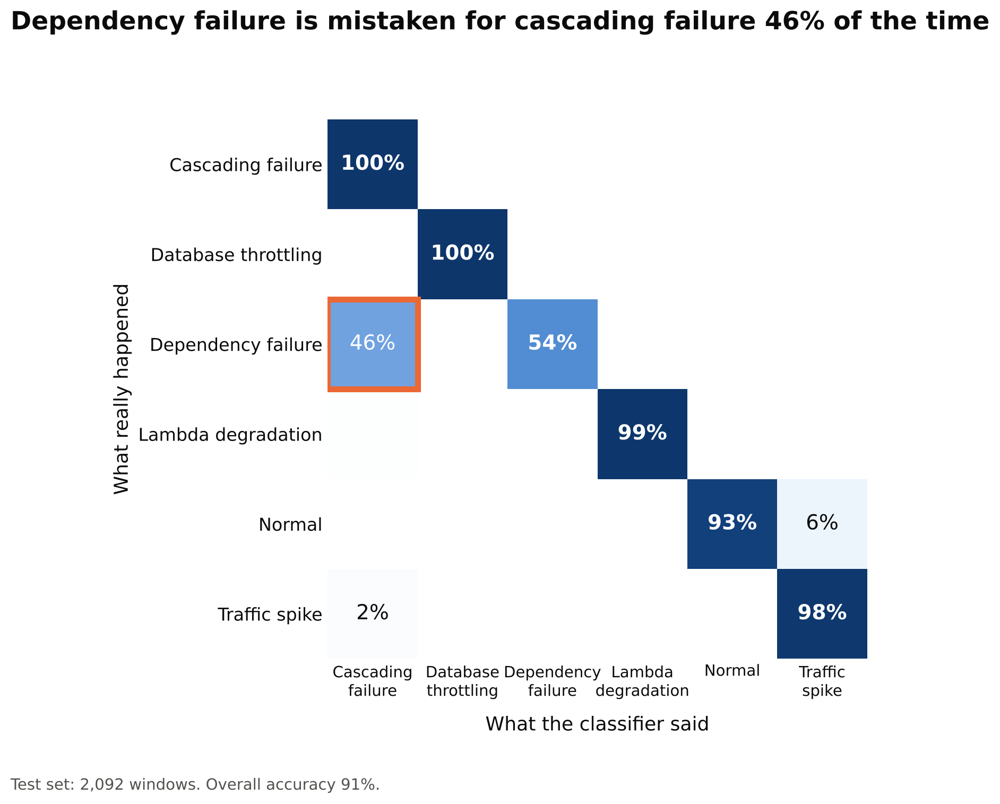
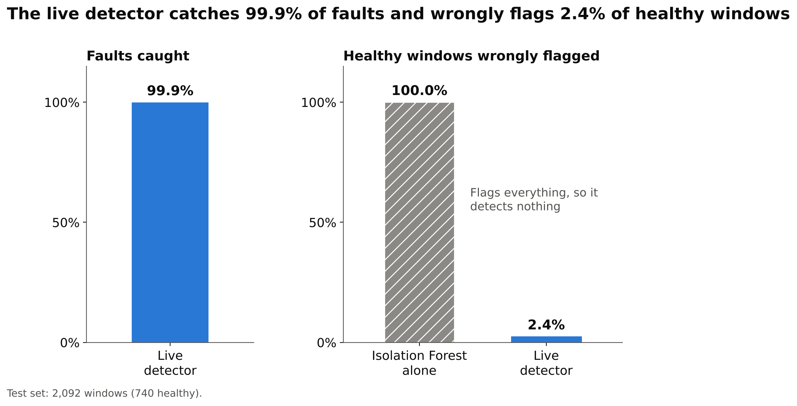
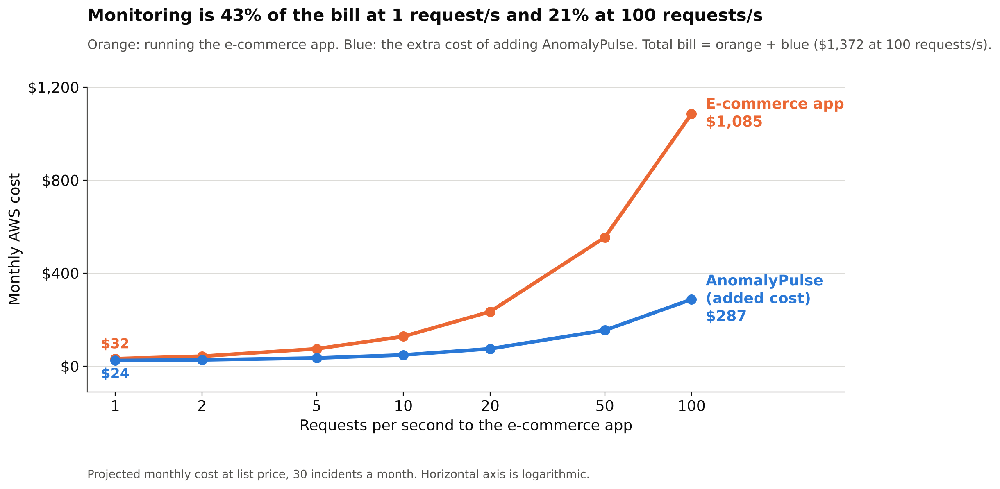

# M9-6 report: latency on the live path, and the report figures

**Status:** final (reviewed 2026-11-25). Latency numbers are from `AnomalyPulse/report/results/latency_m9_6.json`,
built from M9-1's live runs (350 test-set runs, 20 stress runs, 2026-11-13 to 2026-11-16). Every figure is drawn
from result files by one script and can be regenerated (see "How to reproduce"). **Owner:** Linu · **Code:**
`AnomalyPulse/report/latency.py`, `fetch.py`, `make_figures.py` · **Reads:** [`M9-2_REPORT.md`](M9-2_REPORT.md),
[`M9-3_REPORT.md`](M9-3_REPORT.md), [`COST_AND_PERFORMANCE.md`](COST_AND_PERFORMANCE.md), [`PIPELINE.md`](PIPELINE.md),
[`LIVE_DIAGNOSIS.md`](LIVE_DIAGNOSIS.md), [`INCIDENT_STORE.md`](INCIDENT_STORE.md)

## The short version

- **From the start of a fault to a stored diagnosis takes about four minutes.** The median is 249.5 s and 9 in 10
  runs finish within 276 s (284 timed detections on the test set). Detection alone, meaning the fault is noticed and
  its type is named, takes a median of 222 s. Diagnosis (Bedrock, plus storing the result) adds a median of 28 s.
- **Every fault run in the test set had an incident open during its fault.** 284 were detected and timed. The other
  6 were covered by an incident already open when the fault started: in 4 it had opened on a false alarm the minute
  before, and in 2 it was the previous run's incident, still open. None was missed. There were 8 false incidents, one
  on each of 8 of the 60 healthy runs.
- **Detection is not window-dominated. The biggest step is CloudWatch's 2-minute settle.** The ticket expected
  "window-dominated (~1 min)". The one-minute window accounts for about 19% of the mean end-to-end time (median
  52 s). CloudWatch's settle is a fixed 120 s, about 49%: the metrics extractor waits 2 minutes before reading a
  minute. Waiting for the window builder's next run, then building and classifying the window, takes about 20%
  (median 49 s). Diagnosis is about 12%. The reason is in "Why the wait is so long" below.
- **The 15-second-window stretch experiment did not run.** It was an optional stretch goal and needs a 15-second
  window builder, retrained models and new live runs. So there is no latency/stability trade-off to report for
  shorter windows. Shortening the window would shave seconds off the 52 s step and leave the 169 s wait untouched.
- **The detector catches almost every fault and the classifier struggles with one fault type.** The live detector
  flags 99.9% of fault windows and wrongly flags 2.4% of healthy ones. The classifier names Database throttling,
  Lambda degradation and Traffic spike almost perfectly, but names Dependency failure correctly only 54% of the time.
  It calls every one it misses a cascading failure.
- **Monitoring is a minority of the bill and shrinks with scale:** 43% of the total at 1 request/s, 21% at 100 requests/s.
- **All timings are runbooks off.** Every M9-1 run predates the runbooks deploy in the live explain Lambda
  (2026-11-23 05:49 UTC). Do not pool these diagnosis timings with later runs.

## What was measured

Latency is measured on the live path, not in a notebook. For each of M9-1's runs the clock starts at the real fault
start, the first fault's `active_from` in the run's manifest, and stops when the incident and its first diagnosis
are stored. Four steps sit between the two:

1. **The one-minute window.** The live path judges a minute only once it ends, so a fault that starts partway
   through a minute shows first at that minute's end, if the classifier sees it in that minute. When the fault ran
   for less than half of its first minute (under 30 s), the classifier missed it there in about half the runs (89 of
   171), and the incident opened on the next minute. When it ran 30 s or more, that almost never happened (1 of
   113). So 90 of the 284 runs (32%) waited one extra minute. The live system never sees the labels; this is the
   classifier.
2. **CloudWatch's settle.** The metrics extractor reads a minute only once 2 more minutes have passed, so that
   CloudWatch has finished publishing it (`METRICS_LAG_MINUTES = 2`), and the full window needs that snapshot. This
   step is a fixed 120 s, set by configuration, not measured.
3. **The window builder's next run, building the window and classifying it.** The window builder runs once a
   minute at about :45, so a minute's full window is ready about 2¾ minutes after the minute ends
   ([`PIPELINE.md`](PIPELINE.md), "When a minute's window is ready"). Building it takes about 4 s and classifying it
   under 1 s. This step has a median of 49.4 s (48.7 to 54.2 s). Steps 2 and 3 together are the record's
   `window_end_to_diagnosis_s`: a median of 169.4 s, with almost no spread (168.7 to 174.2 s).
4. **Diagnosis.** The diagnosis Lambda asks the explain Lambda (Bedrock) for an explanation and the incident store
   writes the result. Bedrock alone is a median of 27.6 s of the 28.3 s.

Detection latency is steps 1 to 3. End-to-end latency is all four.

| Step (test set, 284 timed detections) | Median | Mean | 90th percentile | Share of mean |
| --- | --- | --- | --- | --- |
| 1-minute window | 52.4 s | 47.6 s | 75.4 s | 19% |
| CloudWatch's settle (fixed) | 120.0 s | 120.0 s | 120.0 s | 49% |
| Next window-builder run, build and classify | 49.4 s | 50.0 s | 52.1 s | 20% |
| Diagnosis (Bedrock and store) | 28.3 s | 29.3 s | 42.6 s | 12% |
| **Detection (steps 1 to 3)** | **222.0 s** | 217.6 s | 245.0 s | |
| **End to end** | **249.5 s** | 246.9 s | 276.4 s | |

The step medians (52.4 + 120 + 49.4 + 28.3 = 250.1 s) come close to the end-to-end median (249.5 s), but medians do
not add in general. The figure draws each step's median and the end-to-end median separately.

**What the console showed.** For 8 of the 284 runs (slots 734, 756, 776, 778, 817, 904, 927 and 960), the first
diagnosis stored was held back for causal or ordering wording ("Severity pending",
[`INCIDENT_FEED.md`](INCIDENT_FEED.md)). The console showed a diagnosis only after the store's retry on the next
counted minute, about a minute later than its end-to-end time. Each retry was kept. The console's own poll, within
15 s, is not measured.

### By fault type

| Fault type | Runs timed | Waited an extra minute | Window | Pipeline wait (steps 2 and 3) | Diagnosis | End to end |
| --- | --- | --- | --- | --- | --- | --- |
| Traffic spike | 80 | 9 | 37.1 s | 171.3 s | 26.5 s | 234.2 s |
| Database throttling | 71 | 13 | 40.3 s | 169.1 s | 30.2 s | 243.1 s |
| Cascading failure | 29 | 9 | 52.5 s | 170.1 s | 28.8 s | 252.3 s |
| Dependency failure | 48 | 29 | 64.7 s | 169.3 s | 27.6 s | 259.8 s |
| Lambda degradation | 56 | 30 | 62.4 s | 169.1 s | 28.7 s | 260.8 s |

Medians. The pipeline wait and diagnosis barely change by type. The window step is what differs, from 37 s for
traffic spike to 65 s for dependency failure, and the extra minute is why. Take the runs where the fault ran under
half of its first minute. Dependency failure (29 of 30) and Lambda degradation (29 of 33) almost always waited for
the next minute. Traffic spike (9 of 47) and Database throttling (13 of 43) usually did not, and cascading failure
falls in between (9 of 18). The faults start at about the same point in their minute (a median of 18 to 25 s of
fault in it, by type). So the difference is how much of a minute the classifier needs to see each fault. Why it
needs more for those two types was not tested.

### Compared with M9-2's offline detection latency

M9-2 measured the live rule's detection latency offline on the same test set: a median of 70.6 s
(`metrics_m9_2.json`, `detection.deployed.headline.latency`). The live window step is shorter (median 52.4 s),
although both stop the clock at the end of the first flagged minute. There are two reasons:

- **M9-2 credits only labelled fault windows.** A minute in which the fault ran less than 30 s is labelled NORMAL, so
  flagging it does not count. The live store opens an incident on any flagged minute. In 82 of the 171 runs whose
  fault ran under 30 s of its first minute, the live incident opened on that minute.
- **M9-2 starts DB throttling's clock at `label_from`**, after the injector has started.

### Stress slice

The 20 stress runs, all detected, behave the same way. Window 58.2 s, CloudWatch's settle 120 s, next
window-builder run, build and classify 49.2 s, diagnosis 26.2 s, end to end 254.4 s (maximum 270.5 s). One first
diagnosis was held back. The stress slice is summarized apart from the test set and is not pooled into the figures.

### Runs left out of the timings, and how incidents are matched to runs

- **Covered (6 runs).** An incident was already open when the fault started, so the run is counted as detected but
  its steps are left out: the clock would start after the incident.
  - **Slots 707, 930, 1031 and 1049: a false alarm the minute before.** The incident opened on the healthy minute
    just before the fault (it ended 8 to 30 s before `active_from`). The Diagnosis Lambda's logs show each of those
    minutes as a low-confidence traffic-spike call (0.52 to 0.74), the shifted traffic mix's false alarm. It is the
    same kind of false alarm as the 2.4% on healthy windows in M9-2 and M9-3. The fault arrived in the next minute
    and was named at 0.97 to 1.0. An incident closes only after 2 quiet minutes in a row, so it stayed open and took
    the fault's type. Nothing acted early: the logs show each fault's effect starting in its own minute.
  - **Slots 764 and 818: the previous run's incident.** It opened 528 and 545 s before the fault and never closed.
    One-minute low-confidence traffic-spike calls kept breaking the 2 quiet minutes in a row it needed to close.
- **Missed: none.**
- **False incidents (8).** One on each of 8 healthy runs (slots 706, 737, 751, 814, 840, 901, 917 and 1010). None
  opened and closed before a fault started.
- **Matched by time, not by `experiment_id`.** The store reads an incident's `experiment_id` from the experiment
  lock when the incident opens. That is when its first minute is classified, about 4 minutes after the minute
  starts ([`INCIDENT_STORE.md`](INCIDENT_STORE.md)). For 4 incidents the next run held the lock by then: the
  detections of 2-minute faults in slots 733, 839 and 975, and slot 751's false alarm. So `latency.py` gives each
  incident to the run that started last at or before the incident's first minute. Matched by `experiment_id`
  instead, those three runs read as missed and the false alarm as the next run's.

290 fault runs on the test set: 284 timed, 6 covered, 0 missed. These counts, and every step's median, mean and 90th
percentile, were also recounted independently from the raw S3 manifests and the Incidents table. They agree, and
the manifests in `report/data/manifests.json` match S3 for all 370 runs.

### Why the wait is so long

A window's full feature row has 106 columns, and the CloudWatch ones exist only once the metrics extractor writes
its snapshot. The Diagnosis Lambda refuses a window with any empty value. The 169 s between a minute's end and its
classification has two parts ([`PIPELINE.md`](PIPELINE.md), "When a minute's window is ready"):

- **120 s is CloudWatch's settle.** The extractor waits `METRICS_LAG_MINUTES = 2` minutes after a minute ends, so
  CloudWatch has finished publishing it.
- **About 49 s is scheduling.** The window builder runs once a minute at a fixed second, about :45, drawn when its
  schedule rule was created. A minute whose snapshot is ready waits for that run. Then building the window takes
  about 4 s and classifying it under 1 s.

Both were deliberate design choices, decided on 2026-11-01 and measured on 2026-11-04 and 05. They are why the live
path is slower than the offline detection latency, which stops the clock at the end of the window.

Shortening either would speed detection up. A shorter lag risks reading a minute CloudWatch has not settled yet,
and the builder's second has to stay between about :20 and :50 for the dashboard's deadlines
([`PIPELINE.md`](PIPELINE.md)). Neither was tried in M9. The 15-second-window experiment would address the 52 s step
only.

## The figures

All six are in `Docs/images/m9-6/` as PNG (200 dpi) and SVG. SVG text stays text, so it can be searched. Colours
keep one meaning across the set: blue is AnomalyPulse, red a problem (false alarms, the degraded class and its
largest confusion), and orange only CloudWatch's settle in figure 6.

### Figure 1: confusion matrix



Each row is a true fault type and shows where its windows were sent, as a percentage of the row. The largest
off-diagonal cell is boxed in red: 46% of dependency-failure windows are named cascading failure. Overall accuracy is
91% over the 2,092 test windows. Cells marked <1% hold 1 or 2 windows. Source: `metrics_m9_2.json`.

### Figure 2: detection



The live detector (the Isolation Forest flags the window **and** the classifier names a fault) catches 99.9% of
fault windows and wrongly flags 2.4% (18 of 740) of healthy ones. The Isolation Forest on its own flags all of the
healthy windows, so it is drawn once, in a grey card, as the reason the classifier is needed, not as a result. As the
forest flags every test window, the live detector's verdict on the test set is the classifier's. Its numbers are
those of the AnomalyPulse classifier in figure 4. Source: `metrics_m9_2.json`.

**Why the forest flags everything:** it was trained on healthy traffic from the default mix. Every test run uses a
shifted traffic mix, which moves a healthy window past the forest's fixed cutoff (-0.3695). On 2026-11-16, 154 of 154
healthy windows were flagged in the shifted mix and 0 of 20 in the default mix
([`M9-2_REPORT.md`](M9-2_REPORT.md)). Its recall and latency are not plotted as a success.

### Figure 3: per-band performance


For each fault type, the share of its test windows the classifier names correctly, in its two held-out bands. Both
bands are held out of training: one lies between the two training bands, and the other just above the stronger one
(the plan's Control 1; M9-2 calls them interpolation and mild extrapolation). Each card shows the band's range and
the validation recall it is judged against. Database throttling is 100% and 100%, Lambda degradation 100% and 99%,
Traffic spike 100% and 99%. Dependency failure is 55% and 57%, marked degraded in red: 43 to 44 points below its
validation recall (99%). Its two bands match each other, so the fault's strength is not what hurts it. M9-2 traces
it to the shifted traffic mix. Source: `metrics_m9_2.json`.

### Figure 4: the classifier's margin over Model 0


Each row is the classifier's margin over Model 0, the simple threshold rule, in percentage points of windows
flagged, with its 95% interval paired by run (M9-3). The rule flags a minute when p95 latency is more than twice
baseline or the 5xx share is above 5%, against the mean of the three minutes before it. Over all faults the margin
is +53 [48, 58]: Model 0 catches 47.2% of fault windows and the classifier 99.9%. By fault type the margins are:

- traffic spike +99 [97, 100];
- Lambda degradation +68 [64, 72];
- Database throttling +52 [47, 56];
- cascading failure +9.3 [3.5, 15.6], the plan's harder case;
- dependency failure 0, because Model 0 already flags all of it.

The price is +2.4 [1.4, 3.6] points of false alarms on healthy windows, where Model 0 raises none. Against the
weaker form of the rule, which compares with the previous minute only, the all-faults margin is +63 [58, 68]. Test
set, headline runs (320 runs, 2,092 windows). Source: `baseline_m9_3.json` ([`M9-3_REPORT.md`](M9-3_REPORT.md)).

### Figure 5: cost curve



Projected monthly cost at list price with 30 incidents a month. Both axes are logarithmic, so the low end reads as
clearly as the high end. Three lines: the total bill, the e-commerce app alone, and what AnomalyPulse adds. The
total is the sum of the other two. At 1 request/s, $32 for the app plus $24 for AnomalyPulse makes $56 (monitoring
43%). At 100 requests/s, $1,085 plus $287 makes $1,372 (monitoring 21%). Source: `projections.json` (built from
`cost/results/measured.json`; see [`COST_AND_PERFORMANCE.md`](COST_AND_PERFORMANCE.md)).

### Figure 6: latency breakdown


The typical run (median of each step): the one-minute window, 52 s; CloudWatch's settle, 120 s; the window
builder's next run, building and classifying, 49 s; diagnosis, 28 s. Detection is 222 s, and the whole path 250 s
(median 249.5 s, rounded half up), with 9 in 10 within 276 s. The title's 49% is the settle's share of the mean
end-to-end time. Source: `latency_m9_6.json`.

## What the figures leave out

Cut so each figure says one thing; all of it is in the result files.

- **The binary detector.** M9-2 also trained a supervised binary detector, an unpromoted alternative to the
  live one. It is not in any figure; the live detector is the system's detector.
- **Intervals on figures 2 and 3.** Figure 4 carries M9-3's paired intervals. The others are in the M9-2 and M9-3
  reports, for example recall 0.999 [0.997, 1.000] for the classifier read as a detector and 0.472 [0.419, 0.521]
  for the stronger rule.
- **The other classifiers.** XGBoost and Random Forest also beat the rule as detectors, but fall to a macro-F1
  of 0.61 to 0.70 as six-class classifiers on the test set.

## Limits

- The claim is limited to the simulator: held-out parameter bands of injected faults. It says nothing about real
  production incidents.
- Every test run uses a shifted traffic mix, so the weak Dependency failure result mixes the held-out bands with
  that shift ([`M9-2_REPORT.md`](M9-2_REPORT.md) points at the mix).
- Latency was measured with runbooks off. Re-measure the diagnosis step before quoting it for the current system.
- The end-to-end time stops at the first diagnosis stored. The console's poll (within 15 s) is not measured, and 8
  of the 284 first diagnoses were held back about a minute longer.
- The 15-second-window experiment was not run: it was an optional stretch goal and needs a 15-second window builder,
  retrained models and new live runs.

## How to reproduce

From `AnomalyPulse/`, with the pinned plotting library (`pip install -r report/requirements.txt`, matplotlib 3.11.2):

```bash
python3 -m report.latency           # rebuilds results/latency_m9_6.json from the exported records
python3 -m report.make_figures      # redraws all six figures in Docs/images/m9-6/ from the result files
python3 -m pytest report            # 53 tests (one skips without jsonschema): the matching rules, and the figures against the data
```

The latency file's inputs are `genai/m9_5/data/records.json` and `retries.jsonl` (M9-5's export of the Incidents
table and the store's retry log lines) and `report/data/manifests.json`. Their hashes, the commit and whether the
working tree had other changes are in the file's `provenance`. A rerun of the figure script on the same inputs
writes the same bytes. `report/fetch.py` re-downloads the manifests from AWS and needs credentials.

## For M10

The headline for the final report and deck is figure 6: about four minutes from fault to stored diagnosis, half of
it CloudWatch's 2-minute settle. Figures 2, 3 and 4 carry the detection story; figure 3's red card is the honest
limit, and figure 4 shows where the classifier's margin comes from.
